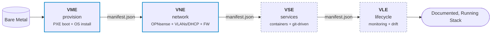

# Velocitee

**Bare metal to a documented, running stack.**

Velocitee Vector is a pipeline of four independent engines that take hardware
from bare metal to a documented, running infrastructure stack. Built for the
people who keep small networks alive: school IT closets, nonprofits, homelabs
— anywhere the operator might be a volunteer who will be replaced in two years
and has to hand off everything they know.

Each engine is small, single-purpose, and useful on its own. The whole stack
runs on a Raspberry Pi. The handoff manifest between engines is JSON you can
read without a tool.

> **Velocitee Vector is 0.1.0 and both implemented engines are alpha.**
> Two of the four engines exist. They run, they have been used against real
> hardware, and their primary execution paths are not yet covered by automated
> tests. Details in
> [velocit-ee/core](https://github.com/velocit-ee/core#project-status--read-this-first).

[](https://github.com/velocit-ee/core/blob/main/LICENSE)
[](https://github.com/velocit-ee/core/actions/workflows/ci.yml)
[](https://github.com/velocit-ee/core/releases)
[](https://www.python.org/)

---

## The Pipeline



Each engine writes a structured **handoff manifest** when it's done. The
next engine reads it and continues. You can enter the pipeline wherever
your hardware already is — bare metal, an existing Proxmox host, a
running OPNsense gateway, an established containerised stack — and you
can stop wherever you like.

---

## Engines & Architectural Stack

### VME — Vector Metal Engine
<!-- ENGINE-STATUS:BEGIN region=engine-pill-vme -->
**Phase 1 · Alpha**
<!-- ENGINE-STATUS:END region=engine-pill-vme -->

Boots target hardware over PXE and runs an unattended OS install. Two
selectable backends, same handoff contract:

- **`builtin`** *(default)* — runs a docker-compose seed stack on a
  laptop or a Pi. dnsmasq + nginx + iPXE + cloud-init. No external
  services required.
- **`maas`** *(optional)* — hands provisioning off to an existing
  [Canonical MAAS](https://maas.io) deployment for operators who
  already run one. Uses the MAAS REST API; we don't ship or
  redistribute MAAS.

Writes `vme-manifest.json` describing the provisioned target —
hostname, IP, MAC, OS, SSH key, timing, the backend that ran it —
which every downstream engine consumes.

→ [velocit-ee/core — vme/](https://github.com/velocit-ee/core/tree/main/vme)

### VNE — Vector Network Engine
<!-- ENGINE-STATUS:BEGIN region=engine-pill-vne -->
**Phase 2 · Alpha**
<!-- ENGINE-STATUS:END region=engine-pill-vne -->

Two paths from one CLI:

- **deploy** — provisions [OPNsense](https://opnsense.org) as a VM on
  Proxmox VE, then configures VLANs, DHCP, DNS, and a baseline firewall.
  Runs an automated verification gate before declaring success. Two
  provisioner backends ship: `velocitee-native` (Python talking Proxmox +
  OPNsense REST directly) and `opentofu+ansible`. The renderer registry holds
  eleven further names (Pulumi, Salt, Chef, Puppet, CloudFormation, Bicep, Nix,
  Helm, Packer, cloud-init, ansible-only) that pass config validation and then
  refuse to run — reserved slots, not options.
- **join** — discovers the network you're already on, identifies the
  gateway, picks a router adapter (OPNsense / unmanaged catch-all /
  pluggable), and writes a join-mode manifest VSE/VLE can consume.
  Read-only end-to-end. Works on any router; richer integration when
  the gateway has a known API.

→ [velocit-ee/core — vne/](https://github.com/velocit-ee/core/tree/main/vne)

### VSE — Vector Services Engine
<!-- ENGINE-STATUS:BEGIN region=engine-pill-vse -->
**Phase 3 · Planned**
<!-- ENGINE-STATUS:END region=engine-pill-vse -->

Deploys containerised services onto the verified network using
idempotent Ansible roles, driven by a config bundle. Designed to be
re-run safely at any time — services converge on the declared state
rather than being imperatively installed once.

### VLE — Vector Lifecycle Engine
<!-- ENGINE-STATUS:BEGIN region=engine-pill-vle -->
**Phase 4 · Planned**
<!-- ENGINE-STATUS:END region=engine-pill-vle -->

Monitoring, auto-documentation generated from the chain of handoff
manifests, configuration drift detection against the declared state,
and single-command repair.

---

## Core Foundation & Dependencies

Velocitee is designed with clean architectural boundaries. Core infrastructure tasks are powered by established, battle-tested open-source components, each carefully chosen to keep the operational attack surface minimal and license boundaries clean.

### Provisioning & boot

| Project | Where it's used | License |
|---|---|---|
| [**iPXE**](https://ipxe.org) | VME chainloader bootstrapped over DHCP/TFTP, built from source in the seed stack and embedded with our boot script | GPL v2 (subprocess / artifact, never linked) |
| [**dnsmasq**](https://thekelleys.org.uk/dnsmasq/doc.html) | DHCP + TFTP for the VME seed stack | GPL v2 (run as service, not linked) |
| [**nginx**](https://nginx.org) | HTTP server for VME boot scripts and OS install assets | BSD-2-Clause |
| [**cloud-init**](https://cloud-init.io) / Ubuntu autoinstall | Unattended OS install driver for Ubuntu Server targets | Apache 2.0 / GPL v3 (target side only) |
| [**Proxmox VE**](https://www.proxmox.com/en/proxmox-virtual-environment/overview) automatic-installer | Unattended Proxmox VE installs | AGPL v3 (target product, not embedded) |
| [**Canonical MAAS**](https://maas.io) | Optional VME backend for operators who already run MAAS | Apache 2.0 (REST API client only — no library import) |

### Networking & virtualisation

| Project | Where it's used | License |
|---|---|---|
| [**OPNsense**](https://opnsense.org) | Network appliance VNE deploys: VLANs, DHCP, DNS, firewall | BSD-2-Clause |
| [**Proxmox VE**](https://www.proxmox.com) | Hypervisor VNE drives via REST API | AGPL v3 (target product) |
| [**OpenTofu**](https://opentofu.org) | Infrastructure-as-code engine for the `opentofu+ansible` VNE backend | MPL 2.0 |
| [**bpg/proxmox**](https://registry.terraform.io/providers/bpg/proxmox/latest) Terraform provider | Proxmox API driver under OpenTofu | MPL 2.0 |
| [**Ansible**](https://www.ansible.com) | OPNsense configuration in the `opentofu+ansible` backend (subprocess, not linked) | GPL v3 |
| [**ansibleguy.opnsense**](https://github.com/ansibleguy/collection_opnsense) collection | OPNsense Ansible roles, version-pinned | GPL v3 |

### Discovery & diagnostics

| Project | Where it's used | License |
|---|---|---|
| [**nmap**](https://nmap.org) | Optional service-version + OS fingerprint enrichment in `velocitee-discover` (subprocess, never imported) | NPSL — see *license boundary* |
| Pure Python stdlib | Default scan path: ARP, mDNS, SSDP listening, TCP connect-scan, banner/HTTP/TLS grabs, SNMP v2c sysDescr | PSF |

### Engine runtime (Python)

| Project | Where it's used | License |
|---|---|---|
| [**Pydantic**](https://pydantic.dev) | All config validation and internal schema models | MIT |
| [**Typer**](https://typer.tiangolo.com) | CLI surface for every engine (vme / vne / velocitee-discover) | MIT |
| [**jsonschema**](https://python-jsonschema.readthedocs.io) | JSON-Schema validation of handoff manifests | MIT |
| [**requests**](https://requests.readthedocs.io) | HTTP client for Proxmox, OPNsense, and MAAS REST APIs | Apache 2.0 |
| [**tenacity**](https://tenacity.readthedocs.io) | Retry/backoff policy on transient API errors | Apache 2.0 |
| [**structlog**](https://www.structlog.org) | Structured logging across the stack — JSON for log shippers, key/value for humans | Apache 2.0 / MIT |
| [**passlib**](https://passlib.readthedocs.io) | OPNsense first-boot password hashing (SHA-512 crypt) | BSD |
| [**PyYAML**](https://pyyaml.org) | velocitee.yml + vme-config.yml parsing | MIT |

### Repository & developer tooling

| Project | Where it's used | License |
|---|---|---|
| [**ruff**](https://docs.astral.sh/ruff) | Lint + format for all Python | MIT |
| [**pytest**](https://pytest.org) | Test runner across all engines | MIT |
| [**pre-commit**](https://pre-commit.com) | Local + CI hook orchestration | MIT |
| [**MkDocs Material**](https://squidfunk.github.io/mkdocs-material) | Documentation site at [docs.velocit.ee](https://docs.velocit.ee) | MIT |
| [**Astro**](https://astro.build) | Marketing site at [velocit.ee](https://velocit.ee) | MIT |

### License boundaries — the rules we hold ourselves to

A few of the projects we depend on have licenses that need care. Every
choice below is deliberate and reviewed:

- **GPL-licensed runtimes** (dnsmasq, ansible, ipxe) — we invoke them as
  *subprocesses* or *services*, never link them into our Python code.
  This is the standard, well-understood OSS coexistence pattern.
- **MPL 2.0** (OpenTofu, bpg/proxmox provider) — file-level copyleft;
  full compatibility with our Apache 2.0 codebase.
- **AGPL** (Proxmox VE, OPNsense as products) — they are the things we
  *deploy onto*, not libraries we import. AGPL applies to forks of
  those projects, not to operators driving their REST APIs.
- **NPSL** (nmap) — modified GPL v2 with extra commercial-redistribution
  restrictions. We invoke the binary and parse its XML output; we never
  import a Python wrapper (`python-nmap` and `python-libnmap` are GPL v2
  and would conflict with Apache 2.0). Self-hosted users install nmap
  themselves; we don't ship it.
- **LGPL** (`python-libmaas`) — declined; we use the MAAS REST API
  directly with `requests` to keep the dependency tree clean.
- **BSL** (Terraform, Packer, Vagrant) — declined; we're on OpenTofu.

---

## Deployment Scenarios

Velocitee is architected for real-world operational environments:

* **Educational & Community IT:** Where IT environments are managed by volunteer or rotating staff. A seed appliance runs VME → VNE to provision physical hardware deterministically, creating permanent, structured manifests that document the environment for future operators.
* **Small & Medium Enterprises (SMEs):** Organizations setting up sovereign on-premises virtualization. VME provisions bare-metal hypervisors (Proxmox VE) on local hardware, while VNE configures enterprise networking, VLAN segmentation, and firewall boundaries.
* **Carrier & Homelab Edge:** Operators with existing network infrastructure can skip bare-metal provisioning and execute `vne join` to map existing topology and gateways in read-only mode, providing seamless handoff to services (VSE) and lifecycle management (VLE).
* **Enterprise MAAS Environments:** For operators already running Canonical MAAS for fleet inventory, VME integrates via REST (`backend: maas`) to orchestrate provisioning while handing off identical manifests to downstream engines.

---

## Quick Start & Installation

```bash
# Install VME on a seed machine (laptop or edge appliance)
curl -fsSL https://raw.githubusercontent.com/velocit-ee/core/main/vme/install.sh | bash
cd ~/vme/vme

vme setup       # Interactive configuration wizard
vme preflight   # Verify network interfaces and services
vme deploy      # Power on the target — automated zero-touch install
```

When VME completes, it outputs a validated handoff manifest for VNE. Each engine seamlessly passes control to the next stage in the pipeline.

→ Comprehensive guides: [docs.velocit.ee](https://docs.velocit.ee)

---

## Configuration Hierarchy

Every engine deterministically resolves configuration from:

- A local `velocitee.yml` (or engine-specific configuration file such as `vme-config.yml`)
- A Git repository referenced by the engine runtime

Centralized configuration registries, automated drift alerts, and fleet policies are managed through carrier and enterprise control planes.

---

## Licensing & Commercial Architecture

Velocitee is built on a clear, sustainable open-core and carrier partnership model:

* **Open-Source Core Engines (Apache 2.0):** The foundational engine stack—VME, VNE, VSE, and VLE—is permanently open source under the Apache License 2.0. Organizations and developers are free to inspect, run, modify, and build on the core engines without fees.  
  → [velocit-ee/core](https://github.com/velocit-ee/core)
* **Proprietary Carrier & Enterprise Solutions:** Carrier-grade CPE gateway daemons ([Vector Gateway](https://github.com/velocit-ee/vector-gateway)), hardware-enforced kernel quarantine drivers, sovereign privacy cleanrooms (Velocitee Prism), and multi-tenant fleet management are licensed commercially for telecommunications carriers and enterprise environments.
* **Community & Educational Access:** Academic institutions, research labs, and registered non-profit organizations receive complimentary access to standard community templates and operational tooling.

---

## Documentation & Resources

- **Documentation:** [docs.velocit.ee](https://docs.velocit.ee) — Architecture guides, references, and tutorials
- **Core Engine Repository:** [velocit-ee/core](https://github.com/velocit-ee/core) — VME, VNE, VSE, VLE, and shared libraries
- **Carrier Gateway Repository:** [velocit-ee/vector-gateway](https://github.com/velocit-ee/vector-gateway) — Native Rust edge daemon
- **Website:** [velocit.ee](https://velocit.ee)
- **Organization Profile & Brand:** [velocit-ee/.github](https://github.com/velocit-ee/.github)

---

## Contributing

Contributions from the community are warmly welcomed. All pull requests submitted across the `velocit-ee` organization are covered by the [Contributor License Agreement](https://github.com/velocit-ee/core/blob/main/CLA.md), ensuring that contributions can be defended, maintained, and licensed effectively.

Please review our [Contributing Guide](https://github.com/velocit-ee/.github/blob/main/CONTRIBUTING.md) and [Code of Conduct](https://github.com/velocit-ee/.github/blob/main/CODE_OF_CONDUCT.md) prior to submitting pull requests.

---

<!-- ENGINE-STATUS:BEGIN region=trailing-status -->
```
license:  Apache 2.0 (engines)
status:   VME alpha · VNE alpha · VSE planned · VLE planned
```
<!-- ENGINE-STATUS:END region=trailing-status -->
